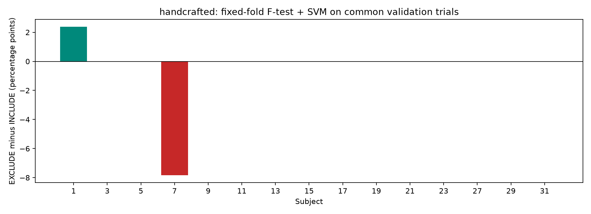

# Homework 1, Question 2: fixed-fold trial-exclusion comparison

## Main finding

Removing the two suspected high-amplitude training trials did not have a uniform effect. For F-test + SVM, subject 1 improved while subject 7 declined. These are exploratory within-subject results on fixed held-out validation trials; they do not establish whether the extreme signals contain useful neural activity or artifact-related class cues.

## Experiment

- Data: 15 subjects, 21 original trials per subject; channels 1/right and 4/left; 500 Hz.
- Suspected trials: subject 1 / trial 6 (channel 4 finding), and subject 7 / trial 21 (both channels). Exclusion removes the complete paired-ear trial.
- Original trial-level three-fold assignments are preserved. All three overlapping five-second windows from one trial remain in the same fold.
- **Include:** retain suspected trials whenever they belong to training.
- **Exclude:** remove their three windows whenever they belong to training.
- **Primary evaluation:** the same nonsuspected validation windows under both policies. Suspected held-out trials are reported separately.
- Training-only standardization, feature selection and random oversampling are repeated for each changed training set. Models and settings remain fixed.
- Metric: mean of the three fold Macro-F1 scores, using labels [-1, 0, 1]. Cohort means give each subject equal weight. No separate independent test set is available.

## Preprocessing and features

The original archive is loaded again, preserving all 315 trials. Default preparation subtracts each trial/channel mean and adds no extra notch. Five fourth-order Butterworth bandpass filters provide delta (1–4), theta (4–8), alpha (8–12), beta (12–30) and gamma (30–45 Hz) features. Eight statistics per band and ear produce 80 handcrafted features. MI or F-test selects 20 features inside each training fold. The fixed classifiers are SVM, LDA, Decision Tree and XGBoost.

Physical units, acquisition reference and prior preprocessing are undocumented. The uV setting is an assumption. The 100-uV reference does not automatically delete trials. No wavelet, WQN or ASR correction has been applied in this experiment.

## F-test + SVM: affected subjects

| Subject | Keep suspected training trials | Exclude suspected training trials | Exclude minus include (percentage points) |
| --- | ---: | ---: | ---: |
| 1 | 0.261202 | 0.284942 | +2.374 |
| 7 | 0.374954 | 0.296572 | -7.838 |

The other 13 subjects have exactly zero differences. Subject 1's previously observed decline after deletion does not persist when the original folds and common evaluation samples are preserved. Subject 7's decline persists; removal also changes training size, class composition, scaling and feature selection.

## All eight handcrafted combinations: mean across 15 subjects

Positive differences favor exclusion. These means use the common validation samples, including for the INCLUDE policy.

| Selector | Model | Include Macro-F1 | Exclude Macro-F1 | Difference (percentage points) |
| --- | --- | ---: | ---: | ---: |
| F-test | Decision Tree | 0.312685 | 0.325807 | +1.312 |
| F-test | LDA | 0.337846 | 0.330963 | -0.688 |
| F-test | SVM | 0.352910 | 0.349267 | -0.364 |
| F-test | XGBoost | 0.331796 | 0.334553 | +0.276 |
| MI | Decision Tree | 0.321223 | 0.328819 | +0.760 |
| MI | LDA | 0.330368 | 0.331067 | +0.070 |
| MI | SVM | 0.331117 | 0.330682 | -0.043 |
| MI | XGBoost | 0.319646 | 0.321245 | +0.160 |

## Subject 7: number of trials per fold

| Fold | Include training | Exclude training | Common validation | Separate suspected validation |
| --- | ---: | ---: | ---: | ---: |
| 1 | 14 | 14 | 6 | 1 |
| 2 | 14 | 13 | 7 | 0 |
| 3 | 14 | 13 | 7 | 0 |

Each trial generates three windows. Trial 21 is held out in fold 1, so both training policies are identical for that fold. Across folds, each of the 20 nonsuspected trials is evaluated once under each policy.

## Execution and reliability checks

The handcrafted experiment was executed locally for all 15 subjects, completing in approximately 203 seconds. The saved validation record reports PASS:

- All 120 original baseline subject/model scores reproduced to floating-point precision (maximum absolute difference below 1e-15).
- All 720 paired fold scores reconstructed from saved predictions.
- 15,024 common-validation prediction rows and 96 separate suspected-validation prediction rows.
- 392 actual model fits; 328 identical training pipelines reused.
- Matched validation samples and trial grouping checked; all 13 unaffected subject differences exactly zero.

The notebook contains an optional frozen SingLEM comparison with identical fold policies, but **SingLEM was disabled in this local run**. No SingLEM comparison results are included or inferred. Its Kaggle branch is enabled by default; review the unit assumption before execution.

See [local_validation.json](local_validation.json) for execution scope and package versions, and [configuration.json](results/configuration.json) for the saved run settings. The notebook installs missing packages rather than pinning the complete environment, so results from different library versions should be checked against the saved baseline.

## Reading and reproducing the results

1. Open [the notebook](LMB_Q2_Fixed_Fold_Comparison.ipynb) in Kaggle and run from the beginning. Set `RUN_SINGLEM=False` for the locally validated scope, or run the optional SingLEM branch separately.
2. Start with [F-test + SVM subject results](results/handcrafted_focus_Ftest_SVM.csv). Compare `include_common_macro_f1` against `exclude_common_macro_f1`; positive `delta_percentage_points` favors exclusion.
3. Read [all subject/model results](results/handcrafted_paired_subject_results.csv) and [cohort summaries](results/handcrafted_paired_cohort_summary.csv).
4. Inspect [fold assignments](results/fixed_fold_comparison_audit.csv), [paired fold scores](results/handcrafted_paired_fold_scores.csv), and [common-validation predictions](results/handcrafted_common_validation_predictions.csv).
5. Read [suspected trial diagnostics](results/handcrafted_suspected_trial_diagnostics.csv) separately. `original_full_validation_macro_f1` reproduces the earlier baseline and must not replace the common-sample comparator.

Kaggle saves outputs in `/kaggle/working/results` and exports `/kaggle/working/Fixed_Fold_Comparison_Results.zip`. The original signals and pretrained weights are not committed; the notebook obtains its required inputs as documented in its loading cells. The source archive SHA-256 is recorded in configuration.

## Interpretation limits

This analysis measures the influence of two declared trials on particular classifiers. It does not validate an artifact detector, establish neural origin, or prove that lower amplitudes mean better data. Exclusions were reviewed after earlier results, so this is an exploratory sensitivity analysis. Only two subjects are affected; overlapping windows are not independent samples. Subjects 17 and 31 have insufficient neutral-class trials for full three-fold class coverage. Report these constraints and avoid treating a nominal 0.31 threshold as a proven chance-level Macro-F1 benchmark.

## Provenance

The notebook, execution record and supporting results were taken from `Q2_Fixed_Fold_Comparison_Package.zip`. [SOURCE_PACKAGE.json](SOURCE_PACKAGE.json) records its checksum and the checksums of the extracted files. [README.md](README.md) provides the original package's detailed usage guide.
