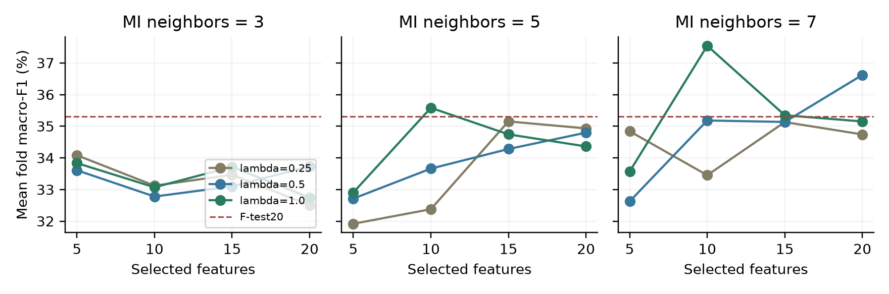
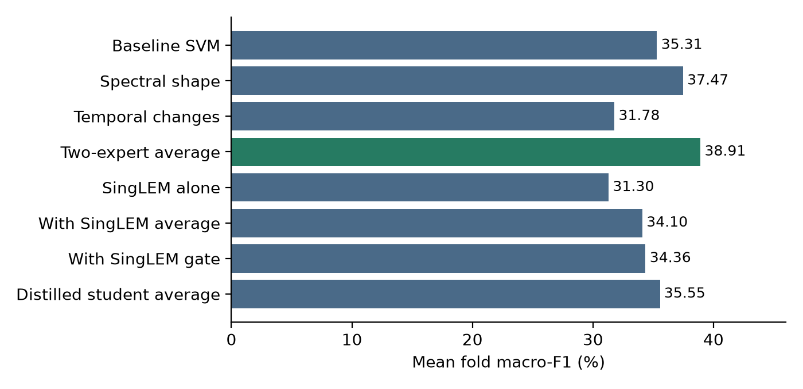

Gain Invariant Spectral and Temporal Experts for Within Subject Ear EEG Emotion Classification

Negin Raki | Student number 402101758

Learning in Brain and Machine | Homework 1 Question 2 | Working manuscript | 16 November 2026

## Abstract

Emotion classification from two ear-EEG channels is challenging when each participant contributes only 21 labeled trials and recordings contain large amplitude anomalies. We investigate a reproducible within-subject pipeline using 15 participants, 315 trials and 945 overlapping five-second windows. Starting from 80 handcrafted features, we examine feature selection, suspicious-trial exclusion, wavelet attenuation, compact representations, mixtures of experts and frozen SingLEM features with teacher-student training. All supervised transformations are fitted within training folds, and overlapping windows from a trial remain together. Our selected final model averages the probabilities of two class-balanced logistic-regression experts: centered log band powers and within-window temporal variance dynamics. On all original validation trials, its mean fold macro-F1 is 38.91% with 43.81% accuracy, compared with 35.31% macro-F1 for the F-test/SVM reference. Trial pooling yields 39.59% macro-F1. Adding the evaluated SingLEM expert or distilling its predictions does not improve the primary endpoint. The observed improvement is heterogeneous across subjects, and subject-bootstrap uncertainty includes zero. These findings support compact complementary representations as a promising direction, while requiring independent confirmation after exploratory model development.

Keywords: ear EEG; emotion classification; within-subject validation; spectral shape; temporal dynamics; mixture of experts; knowledge distillation.

## 1 Introduction

The homework task is to predict negative, neutral and positive emotional valence from the final ten seconds of video-viewing EEG recorded at the right and left ears [1]. Limited channels simplify acquisition but restrict spatial information. The small number of independent trials makes flexible classifiers and routing networks particularly difficult to assess.

Our central question was whether apparent recording problems should be handled by deleting trials, altering the waveform, or learning representations less sensitive to amplitude. We first established a fixed-fold baseline, then investigated the effects of suspicious recordings and denoising. Later experiments tested whether complementary experts could improve on a single representation and whether a pretrained EEG encoder could add useful information.

The main contribution is an empirically examined two-expert system that separates spectral shape from temporal changes. We also document unsuccessful alternatives and the safeguards needed to compare them fairly. This is a Question 2 manuscript; the separate classical-classifier task in Question 1 is outside its scope. The model comparison is exploratory because the same cohort and folds informed successive design decisions.

A further mRMR ablation examines whether penalizing redundant features helps compact selection, and whether inner validation can reliably choose the favorable settings. Its distinction between the highest observed fixed setting and the performance of the tuning procedure is central to interpreting the experiment.

## 2 Data and Evaluation Protocol

### 2.1 Dataset and window construction

The original archive contains subjects 1, 3, 5, 7, 9, 11, 13, 15, 17, 19, 21, 23, 27, 29 and 31. Each has 21 trials stored as six-channel, 5,000-sample arrays. Following the assignment, channels 1 and 4 are interpreted as right and left ear recordings at 500 Hz. Each trial is ten seconds long. Labels are -1 for negative, 0 for neutral and +1 for positive. The dataset contains 120 negative, 60 neutral and 135 positive trials.

We subtract the mean separately from each complete trial/channel, preserve the supplied acquisition reference and extract windows beginning at 0, 2.5 and 5 seconds. Each subject therefore contributes 63 windows. The supplied signals are already described as preprocessed; physical calibration and the preceding acquisition/preprocessing chain are not independently established. Native amplitudes are treated as assumed microvolts only where a unit conversion is required.

### 2.2 Trial-level stratified cross-validation

Each subject is evaluated independently using three-fold stratified splitting of the 21 trial labels, shuffled with seed 42 [2]. All three overlapping windows of a trial stay in one partition. Original fold membership is frozen and verified. In the inclusion condition, an outer fold has 14 training and seven validation trials. There is no pooling of subjects for supervised training.

Standardization, feature ranking, correlation pruning, class balancing and classifier fitting use only the corresponding training partition. They are repeated inside inner splits when producing gate-training predictions. Validation examples are never oversampled. Subjects 17 and 31 each have only one neutral trial, so no three-fold split can contain neutral examples in every fold. Missing classes are retained in the metric definition rather than hidden.

### 2.3 Endpoints and uncertainty

For each fold, macro-F1 is the arithmetic mean of the F1 scores for the three fixed labels [-1, 0, 1], with undefined values set to zero. Fold scores are averaged within each subject, then averaged equally across subjects. Standard deviations reported in the tables describe between-subject variation after fold averaging. Accuracy is a separate endpoint; it may favor majority classes even when macro-F1 declines.

The primary revised endpoint uses all 315 original validation trials, or 945 windows. The earlier sensitivity experiments also report a common population of 313 nonsuspected trials, or 939 windows. These endpoints are explicitly separated. Trial-level evaluation averages the three class-probability vectors before taking the predicted label. It is not interchangeable with window-level F1 or with F1 computed once from pooled cohort predictions.

Paired uncertainty for the final model versus the reference is estimated by resampling the 15 subjects 10,000 times. This respects clustering of overlapping windows, but does not correct for multiple comparisons or repeated development. Only seed 42 was executed in the compared final runs; a repeated-seed confirmation is not available.

## 3 Features and Expert Models

### 3.1 Handcrafted reference and compact sets

The reference uses five bands: delta 1-4, theta 4-8, alpha 8-12, beta 12-30 and gamma 30-45 Hz. Fourth-order forward/backward Butterworth filters are applied per complete trial. Each band and ear contributes mean, standard deviation, mean absolute first difference, its normalized version, mean absolute lag-two difference, its normalized version, relative power and Gaussian differential entropy. This produces 80 features. Lag-two difference means |x(t+2)-x(t)|, not the second derivative. The relative-power denominator remains 1-100 Hz.

F-test ranks features by class separation relative to within-class variation. Mutual information (MI) estimates feature-label dependence and can capture nonlinear associations [3]. The historical pipeline retains 20 ranked features, then oversamples training classes. Later experiments compare class weighting, MI neighborhood sizes 3 and 7, selection of 20 versus 10 features, and removal of highly correlated features using training-trial means at |r| >= 0.85.

A10 contains five log band powers per ear. B19 adds five inter-ear log-power differences and theta/alpha and beta/alpha log ratios per ear. C27 adds Hjorth mobility and complexity, spectral entropy and permutation entropy. B19 is contained in C27, which limits their independence as experts. Welch spectra use Hann windows of 1,000 samples, 500-sample overlap and constant detrending. Band integration uses interpolated endpoints and trapezoidal integration.

### 3.2 Final spectral-shape and temporal experts

For each ear, Shape10 subtracts the mean of the five log band powers from each log power: z(e,b) = log P(e,b) - mean_b log P(e,b). Under an independent constant positive gain g(e), every log power receives the same additive term 2 log g(e), which cancels. This yields ten spectral-shape features, with one linear dependency per ear. Numerical tests verified invariance away from the power floor of 1e-30.

Temporal12 uses theta, alpha and beta signals filtered at 500 Hz. Each five-second window is divided into five one-second chunks. For each ear and band, the slope and standard deviation of the five log variances are extracted, giving 12 features. A constant gain adds an offset to all five values, leaving both slope and spread unchanged. These features describe changes within a window; they do not guarantee resistance to muscle activity or frequency-dependent distortion.

Each final expert uses training-fold StandardScaler and balanced logistic regression with C = 0.1. All features are retained. The final probability is p(y|x) = 0.5 p_shape(y|x) + 0.5 p_temporal(y|x); the largest probability determines the class. Missing training classes receive zero probability in the aligned output. Equal ties follow label order [-1, 0, 1]. The selected system is a fixed-weight mixture with no learned conditional gate.

### 3.3 Learners and routing controls

Reference learners are RBF SVM (C=1, gamma=scale), shrinkage LDA, a depth-three decision tree with minimum leaf size two, and XGBoost with 100 depth-two trees, learning rate 0.05 and L2 penalty 1. The revised comparison adds logistic regression. Learned constant and recording-dependent gates minimize class-balanced Brier loss on inner out-of-fold predictions pooled by trial, with a sum-of-squares penalty of 1. Recording descriptors are log RMS, crest factor, largest one-second energy fraction and gamma-power fraction for each ear. Ineligible rare-class folds use equal routing; six of 45 folds require this fallback.

## 4 Recording Challenges and Preprocessing Experiments

### 4.1 Why suspicious-trial deletion was inconclusive

An early amplitude screen flagged nine trials in four subjects. These ranged from short crossings to persistent extreme signals; blanket deletion would have affected classes unequally. Neutral trials were flagged more often (4/60) than negative trials (1/120) or positive trials (4/135). A threshold crossing therefore did not justify discarding a complete trial. Physical units were also uncertain.

Two recordings warranted closer review. Subject 1/trial 6 had a particularly extreme left-ear signal, whereas subject 7/trial 21 showed sustained high amplitude in both ears. We preserved the original folds and compared keeping versus excluding these trials from training on identical nonsuspected validation samples. F-test/SVM improved for subject 1 from 26.12% to 28.49% macro-F1, but declined for subject 7 from 37.50% to 29.66%. The other 13 subjects were unchanged. A score change after removal cannot identify neural informativeness: training size, class composition, scaling and selected features also change.

### 4.2 Could subject 7 trial 21 be a gain problem

The centered RMS amplitude of subject 7/trial 21 was 69.73 and 58.28 times the other-trial medians in the right and left ears. Its highest-energy one-second intervals accounted for only 11.96% and 12.72% of total energy, indicating persistent elevation rather than one short spike. However, normalized spectra were also different: beta fractions were 57.05% and 51.72%, compared with other-trial medians of 25.79% and 21.84%; gamma fractions were 15.12% and 15.31%, versus 3.17% and 2.33%. A scalar gain cannot remove these spectral differences. We therefore treated a gain error as an unconfirmed hypothesis and retained all trials in the main endpoint.

Figure 1. Subject 7/trial 21 compared with the other 20 trials of the same subject. Amplitude ratios and normalized spectra indicate both sustained amplitude elevation and altered spectral shape. The percentile envelope is descriptive, not a confidence interval. Source: saved trial audit.

## 5 Baseline and Development Experiments

### 5.1 Required eight-way handcrafted comparison

Table 1. Full original-validation baseline: 15 subjects, all 315 trials, seed42, Original80, top20 selection and training-only oversampling. SD is between subjects, not between folds. Source: archived baseline full-validation fold scores.

| Selector | Classifier | Mean F1 % | SD pp |
| --- | --- | --- | --- |
| F-test | Decision Tree | 31.22 | 8.21 |
| F-test | LDA | 34.33 | 4.65 |
| F-test | SVM | 35.31 | 5.25 |
| F-test | XGBoost | 33.37 | 7.08 |
| MI | Decision Tree | 32.20 | 8.63 |
| MI | LDA | 33.55 | 5.34 |
| MI | SVM | 33.17 | 7.62 |
| MI | XGBoost | 32.03 | 8.77 |

F-test/SVM was the strongest of these eight fixed baseline combinations. Its full-population macro-F1 of 35.31% was reproduced by the later foundation-assisted run. The frequently cited 35.29% reference is the same family of baseline evaluated on the earlier common nonsuspected population; those values must not be used interchangeably.

### 5.2 Wavelet attenuation and the first mixtures

A channel-wise stationary wavelet experiment used sym4 at seven levels, reflection padding, and detail-coefficient capping at the median plus or minus six robust standard deviations; the approximation was retained. On the common population, F-test/SVM declined from 35.29% to 34.60% macro-F1. F-test/tree rose from 31.27% to 32.57%, showing that an effect for one classifier did not establish a generally better preprocessing method. Subject 1/trial 6 remained extreme after attenuation, while subject 7/trial 21 was almost unchanged. The final model therefore uses no added wavelet step.

Compact C27/SVM reached 35.66% on the common population. An initial mixture of C27, B19 and Original80/F-test SVMs reached 35.94%, versus 35.24% for equal voting. Those experts emitted hard votes and shared substantial information. In the saved run no learned weight exceeded 0.5, so a two-expert majority remained unchanged; differences arose only when all three disagreed. This motivated a clearer separation of amplitude, spectral-shape and temporal evidence.

The revised compact study evaluated 60 configurations with five learners. On all validation windows, Original80 with MI7, up to ten features and correlation pruning reached 36.40% using SVM. Concatenating Shape10 and Temporal12 into Invariant22 reached 38.25% with LDA and 38.02% with logistic regression. These are descriptive development comparisons; the best setting was not selected on a separate untouched cohort.

## 5 Development Experiments continued

### 5.3 Minimum redundancy maximum relevance selection

The mRMR experiment asks whether individually informative features repeat too much of the same information. This matters for Original80: amplitude statistics, entropy and neighboring-band measurements can describe related signal properties. In the exported greedy ranking, candidate relevance is its estimated feature-label mutual information; the penalty is its mean estimated redundancy with previously selected features. The selection score is relevance minus lambda times mean redundancy. A larger lambda places more emphasis on avoiding repeated information. This is a feature-ranking criterion, not an estimate of emotional causality.

The run retains all 315 original trials and 945 validation windows, uses the fixed seed42 folds and enables training balancing. The grid crosses four feature counts (5, 10, 15 and 20), three redundancy penalties (0.25, 0.5 and 1.0), and three MI neighborhood sizes (3, 5 and 7): 36 configurations, plus F-test and MI-only controls. The archive also exports a nested-tuning result for every subject and outer fold [9]. The source notebook and inner split assignments are absent, so training-only ranking and inner trial grouping cannot be independently certified from this archive. The saved predictions nevertheless permit direct verification of all 1,710 grid fold scores; each was reconstructed successfully. Each nested outer score also exactly matches its selected configuration in the grid.

Table 2. All-trial window results for the mRMR ablation. The best fixed row is selected descriptively from 36 outer-validation configurations; it is not the result of the nested selection procedure. SD is between subject fold means.

| Configuration | Macro F1 % | Subject SD pp | Accuracy % |
| --- | --- | --- | --- |
| F-test, 20 features | 35.31 | 5.25 | 43.39 |
| MI-only, 20 features | 34.09 | 8.19 | 41.06 |
| Best observed mRMR: 10, lambda1, neighbors7 | 37.54 | 8.77 | 45.82 |
| Nested-selected mRMR | 34.56 | 7.87 | 41.27 |

The highest observed fixed setting uses ten features, lambda1 and seven MI neighbors. It improves macro-F1 by 2.23 points over F-test20 and improves ten subjects while worsening five. Its reported paired interval is [-1.09, +5.69] points and includes zero. Because this setting was identified by inspecting the grid, the interval does not establish an independently selected improvement or correct for the search over configurations. The comparison also changes feature count as well as ranking; it cannot isolate redundancy penalization as the sole cause.

Table 3. Mean fold class-F1 from the saved predictions, with the fixed labels [-1,0,1]. The improvement is concentrated in negative and neutral recognition, rather than a large change in positive-class performance.

| Class | F-test20 F1 % | Best mRMR F1 % |
| --- | --- | --- |
| Negative | 38.15 | 41.14 |
| Neutral | 18.38 | 21.96 |
| Positive | 49.40 | 49.53 |

## 5 Development Experiments continued

### 5.4 Findings from the mRMR ablation

Figure 2. Interaction of feature count, redundancy penalty and MI neighborhood size. Every panel uses the same all-trial window endpoint. The dashed line is F-test20. Curves show exploratory configuration means and are not uncertainty intervals.

First, compactness and redundancy should be considered jointly. The best fixed model retains half as many features as F-test20, but ten features are not generally optimal: averaging across the other grid settings gives 33.34%, 34.09%, 34.45% and 34.40% macro-F1 for 5, 10, 15 and 20 features. Thus the ten-feature peak reflects a parameter interaction rather than a general rule that a smaller vector is always better. Only four of the 36 mRMR settings exceed the F-test reference.

Second, MI estimation is consequential. Averaged across the tested feature counts and penalties, three, five and seven neighbors give 33.31%, 33.95% and 34.94% macro-F1. Increasing the redundancy penalty from 0.25 to 1 raises the corresponding descriptive grid average from 33.81% to 34.38%. These patterns motivate further investigation of estimator stability and redundancy, but they are not independently validated parameter choices. The experiment lacks a complete matched lambda0 grid at every feature count and neighborhood size, so it does not establish the isolated benefit of the penalty.

Third, the ability to find a favorable setting is different from the existence of one. The nested procedure scores 34.56% macro-F1 and 41.27% accuracy, below F-test20. It never selects the globally best observed fixed setting in any of the 45 outer folds. It chooses 22 distinct parameter combinations, indicating substantial variation across training partitions. With about 14 independent outer-training trials per subject, even less information is available inside an inner split. This is consistent with unstable selection under limited data, although the output alone cannot determine whether small sample size, rare classes, implementation choices or another factor caused the result. We therefore do not present 37.54% as the performance of an automatically tuned mRMR system.

Fourth, the selected feature types connect to our representation design. Relative power and normalized lag-difference statistics account for 230 of 450 selected feature occurrences (51.1%) in the best fixed setting. Left-ear alpha relative power appears in 17 of 45 lists and left-ear theta relative power in 15. These are selection occurrences across correlated folds, not independent biological discoveries. Their prevalence is compatible with the motivation for gain-resistant features, but comparison with a matched relevance-only selection frequency is needed before attributing it to mRMR. Absolute-amplitude features also remain selected; mRMR does not make the complete representation gain invariant.

Finally, evaluation objectives matter. The best fixed mRMR model has higher accuracy than the final two-expert mixture (45.82% versus 43.81%) but lower macro-F1 (37.54% versus 38.91%). Under the assignment's macro-F1 objective, the equally weighted spectral and temporal experts remain the selected final system. A future mRMR expert would need to demonstrate complementary held-out errors and a matched mixture improvement; a favorable standalone setting does not establish either benefit.

## 6 Main Results and Ablations

Table 4. Primary window-level results with all trials retained in training when available. All methods share the same frozen validation trials.

| Method | F1 % | SD pp | Accuracy % |
| --- | --- | --- | --- |
| Original80 F-test SVM | 35.31 | 5.25 | 43.39 |
| Spectral shape expert | 37.47 | 7.34 | 42.33 |
| Temporal expert | 31.78 | 7.71 | 35.98 |
| Spectral plus temporal average | 38.91 | 7.62 | 43.81 |

Figure 3. Mean fold macro-F1 on all original validation windows. Foundation and distillation results use the submitted Kaggle result archive; bars are descriptive means, not independent significance tests.

The two-expert average is our selected final model for the primary endpoint: 38.91% macro-F1 and 43.81% accuracy. Its gain over F-test/SVM is 3.61 percentage points. It improves 8 subjects and worsens 7. The paired 95% subject-bootstrap interval is [-0.93, +8.56] points, so the result does not establish statistical superiority.

In the earlier revised three-expert study, adding an absolute-power expert gave 37.47% with equal averaging and 37.66% with quality routing. Shuffled quality inputs gave 37.68%. Quality routing improved only 0.19 points over equal mixing, with a paired interval of [-0.33, +0.70]. The negative control provides no convincing evidence that the recording descriptors learned useful routing. Removing the absolute-power expert produced the selected 38.91% average.

Pooling the final model by trial gives 39.59% macro-F1 and 45.71% accuracy, versus 35.49% and 45.40% for the reference. Excluding the two suspicious trials only from training gives 39.03% window macro-F1. We retain the inclusion result as primary; the higher exclusion value is a separate sensitivity condition, not a replacement final score.

## 7 Foundation Models and Teacher Training

The optional foundation study uses a frozen SingLEM encoder separately on each ear [4]. The executed artifact records code commit 6db5b5af95f12b6180ffa762723a71ef06c92a4b and a checkpoint checksum. Complete trials receive a 0.5-50 Hz fourth-order Butterworth filter and polyphase resampling from 500 to 128 Hz. Assumed microvolts are converted to volts and scaled by 10,000. Each five-second window becomes five nonoverlapping one-second tokens. Token means and standard deviations yield 32 features per ear and 64 after concatenation. A balanced LR classifier is trained on these features inside each outer training fold. The encoder is not fine-tuned.

The executed checkpoint is identified by the saved hash, not by the current repository default. Current upstream code may differ. Our pooling and tokenization are adaptations, and the result cannot establish whether another checkpoint or preprocessing choice would transfer better. Pretraining overlap with this homework dataset has not been independently established.

Table 5. Foundation and distillation results on the same all-trial window endpoint. Student controls use the same soft-target optimizer with alpha=0; distilled students use alpha=0.5.

| Method | Window F1 % | Accuracy % |
| --- | --- | --- |
| SingLEM alone | 31.30 | 38.62 |
| Three experts equal | 34.10 | 41.16 |
| Three experts constant gate | 34.54 | 41.48 |
| Three experts quality gate | 34.36 | 41.48 |
| Spectral matched control | 37.42 | 42.22 |
| Spectral distilled | 37.21 | 46.77 |
| Temporal matched control | 31.85 | 36.08 |
| Temporal distilled | 31.02 | 40.21 |
| Student control average | 38.91 | 43.81 |
| Distilled student average | 35.55 | 46.35 |

For distillation, a teacher classifier predicts each training trial after holding that complete trial out of teacher training. Its three window probabilities are averaged. A student linear classifier combines the real one-hot label and teacher distribution with equal weight. The matched control uses the same optimizer and regularization with no teacher contribution. Outer validation labels are excluded from teacher, student and gate fitting.

SingLEM alone reached 31.30% macro-F1. Adding it to the handcrafted experts reduced equal-mixture F1 to 34.10%; constant and quality gates reached 34.54% and 34.36%. Distillation reduced the combined students from 38.91% to 35.55%. The temporal expert was particularly affected. Teacher predictions were therefore not a useful training signal under this configuration. These negative results concern the tested transfer setup, not every possible EEG foundation model.

The foundation experiment is an extension using a fixed LR head and mixtures. It does not implement the complete optional homework grid of both selectors crossed with all four classifiers on SingLEM features. That grid remains a submission-completeness item rather than an experiment for which results are claimed here.

## 8 Subject Variation and Error Analysis

Table 6. Subject-level fold-mean macro-F1 for the selected final model and reference, using all original validation windows. The model is fixed across subjects; this is not a best-model-per-subject selection.

| Subject | Baseline F1 % | Final F1 % | Change pp |
| --- | --- | --- | --- |
| 1 | 25.24 | 44.67 | +19.42 |
| 3 | 35.14 | 44.08 | +8.95 |
| 5 | 39.95 | 36.92 | -3.02 |
| 7 | 38.63 | 46.46 | +7.83 |
| 9 | 33.93 | 27.77 | -6.16 |
| 11 | 39.21 | 54.34 | +15.14 |
| 13 | 40.14 | 32.24 | -7.89 |
| 15 | 35.28 | 26.12 | -9.16 |
| 17 | 40.74 | 40.04 | -0.70 |
| 19 | 23.48 | 42.35 | +18.86 |
| 21 | 40.11 | 40.11 | +0.00 |
| 23 | 34.79 | 34.50 | -0.30 |
| 27 | 32.01 | 44.91 | +12.90 |
| 29 | 37.57 | 31.86 | -5.71 |
| 31 | 33.42 | 37.34 | +3.92 |

Figure 4. Left: subject-level final-minus-baseline changes. Right: pooled held-out window confusion counts for the final model. Rows are true classes and columns predicted classes. Pooled counts are diagnostic; they are not the averaging procedure used for the primary macro-F1.

The mean fold F1 values for the final system are 41.92% for negative, 28.52% for neutral and 46.30% for positive. Neutral remains the weakest class. This is consistent with fewer neutral trials and, for two subjects, insufficient examples for class coverage in every fold. Neither class weighting nor probability averaging eliminates the shortage of independent labels.

## 9 Discussion and Conclusion

### 9.1 What the experiments support

The strongest observed primary result comes from combining two compact sources of evidence. Spectral-shape features remove per-ear log-power offsets, while temporal features describe how band variance evolves across the five-second window. Their average outperforms either individual expert in mean macro-F1. This supports the usefulness of complementary representations in this cohort, but does not prove that the representations isolate emotion-specific neural activity.

The findings also explain why our original MoE motivation needed revision. B19 and C27 overlap, hard-vote mixtures discard confidence, and a small training set provides limited evidence for a flexible gate. The revised quality gate failed to separate itself convincingly from simple or shuffled controls. The selected model is therefore a fixed equal mixture, while conditional routing remains a future research hypothesis. Its simplicity is part of the empirical result, not a claim of architectural novelty.

### 9.2 Challenges and limits

The mRMR study reinforces the distinction between representation quality and selection reliability. A ten-feature configuration improves the observed reference score, especially for negative and neutral classes, but nested selection does not reproduce that gain. This supports treating redundancy-aware selection as a useful hypothesis while preserving simple controls and explicit separation of tuning and evaluation. The source-code gap in this additional archive limits an independent audit of its inner procedure.

Amplitude anomalies, uncertain physical units, class imbalance and overlapping windows were the main practical challenges. Fixed trial splits showed that a suspected recording could affect different models and subjects differently. Wavelet peak attenuation did not reliably improve classification, and gain-invariant features cannot remove frequency-dependent artifact. The final system should not be described as an artifact detector or as proof that a suspicious trial is physiologically valid.

All experiments reuse a small development cohort. The selected result follows inspection of multiple feature sets and mixtures, and uncertainty intervals include zero. These experiments estimate within-subject held-out-trial performance, not transfer to a new subject. No independent final test set, repeated-seed confirmation, acquisition-stage calibration, or verified clean-signal reference is available. The offline full-trial zero-phase processing also does not constitute a real-time system.

### 9.3 Conclusion and next steps

The final recommended configuration is the equally weighted spectral-shape and temporal logistic-regression mixture with all original trials retained. It achieves 38.91% window macro-F1 and 43.81% accuracy; separately pooled trial predictions achieve 39.59% macro-F1 and 45.71% accuracy. The window-level gain over the reference is 3.61 percentage points. The tested SingLEM addition and teacher training do not improve this result. Confirmation should prioritize predeclared repeated splits or new data, followed by a small number of targeted gate or pretrained-representation ablations.

The mRMR ablation adds a useful qualification: reducing the selected vector to ten redundancy-aware features yields a favorable fixed-setting result, but nested tuning does not recover the gain. We therefore retain mRMR as a compact-selection finding rather than replacing the final model or claiming a validated tuning improvement.

## References

[1] Learning in Brain and Machine. Homework 1, Question 2 and Report Instructions. Sharif University of Technology. Supplied course handout LMB_HW1.pdf, pp. 3-7.

[2] Scikit-learn. StratifiedKFold documentation. https://scikit-learn.org/stable/modules/generated/sklearn.model_selection.StratifiedKFold.html (accessed 15 November 2026).

[3] Scikit-learn. mutual_info_classif documentation. https://scikit-learn.org/stable/modules/generated/sklearn.feature_selection.mutual_info_classif.html (accessed 15 November 2026).

[4] SingLEM: Single-Channel Large EEG Model. Official implementation and pretrained encoder. https://github.com/ttlabtuat/SingLEM. DOI: 10.1109/JBHI.2026.3732223. Executed commit and checkpoint are specified in the reproducibility record.

[5] PyWavelets. Stationary Wavelet Transform documentation. https://pywavelets.readthedocs.io/en/latest/ref/swt-stationary-wavelet-transform.html. Used as implementation context for the archived wavelet experiment.

[6] Local experiment record. Fixed-fold, compact-feature, small-data MoE and wavelet result tables; subject7_trial21_audit/REPORT_FINDINGS.md; Q2_MoE_Revision/validation_results. See the accompanying source map.

[7] Foundation_Expert_Results.zip. User-supplied Kaggle run, 15 subjects, seed42. Configurations, fold scores, predictions and teacher audit. Archive hash is recorded in report/evidence.json.

[8] LMB_HW1_Final_Paper.pdf. User-supplied comparison report. Consulted during development for compact features, redundancy pruning and regularized learners; its numerical results are not presented as results of this project.

[9] mrmr_hyperparameter_results (1).zip. User-supplied mRMR grid and nested-tuning results. All-trial, seed42 comparison; grid metrics reconstructed from 35,910 predictions. Checksums, numerical verification and extracted summaries are recorded in report/mrmr_evidence/audit.json.
