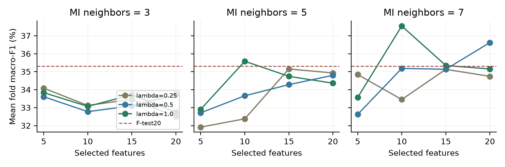

# Results and findings

| Method | Macro-F1 % | Accuracy % |
|---|---:|---:|
| F-test20 control |35.31|43.39|
| MI20 control |34.09|41.06|
| Best observed mRMR: k10, lambda1, MI neighbors7 |37.54|45.82|
| Nested-selected mRMR |34.56|41.27|
| Final spectral-temporal equal mixture, separate earlier run |38.91|43.81|

Scores are mean fold macro-F1, followed by equally weighted subject means, on all original validation trials. The grid settings change the selected feature count and ranking procedure together.

## What the ablations reveal

1. **A compact setting can help, but not consistently.** The best mRMR row improves F-test by2.23 percentage points using10 rather than20 features. Ten subjects improve and five worsen. The reported paired interval is[-1.09,+5.69] points and is not adjusted for picking the best of36 settings. Only4/36 configurations beat the F-test reference. A complete matched lambda0 grid is absent, preventing isolation of the redundancy penalty alone.
2. **Settings interact.** The best feature count is10 only for a particular penalty/neighborhood combination. Averaging across the other settings, feature counts5/10/15/20 give33.34/34.09/34.45/34.40% macro-F1. MI neighbors3/5/7 give33.31/33.95/34.94% averaged across the grid. These are descriptive grid averages, not independent parameter selections.
3. **Tuning does not recover the favorable fixed setting.** Nested selection is0.75 points below F-test. It selects22 different combinations across45 outer folds and never selects k10/lambda1/neighbors7. Limited independent trials are a plausible source of instability, but the missing source notebook prevents determination of the cause.
4. **The gain is concentrated in negative and neutral classes.** Mean fold class-F1 changes from38.15 to41.14% for negative,18.38 to21.96% for neutral, and49.40 to49.53% for positive.
5. **Gain-resistant feature types are common in the selected lists.** Relative power and normalized lag differences contribute230/450 selected occurrences, or51.1%. Left alpha relative power appears in17/45 lists and left theta relative power in15/45. These correlated selection occurrences are not biological significance tests, and mRMR does not make every selected feature gain invariant.
6. **Accuracy and macro-F1 favor different models.** The best observed mRMR row has higher accuracy than the final equal mixture, but lower macro-F1. The assignment's macro-F1 objective therefore retains the38.91% mixture as the final model. Adding an mRMR expert remains an untested hypothesis requiring matched mixture controls and complementary-error analysis.

## Evidence checks

All1,710 grid fold F1 and accuracy values were reconstructed from the35,910 saved predictions. Each configuration has21 held-out windows per subject/fold. All45 nested outer scores equal their selected grid configuration's score. These checks establish consistency of exported results; they do not independently verify inner training/validation separation.
